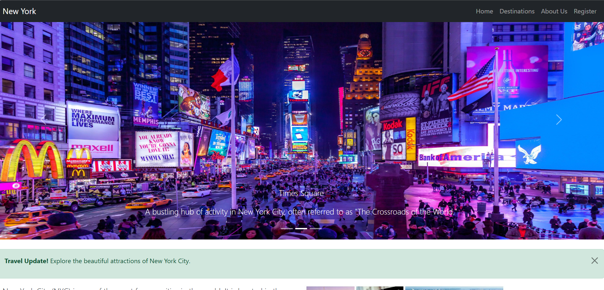
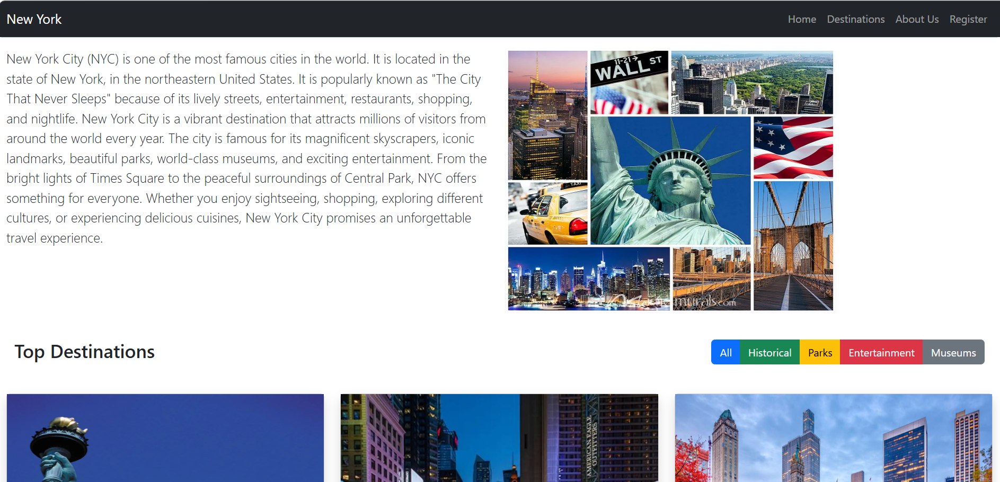
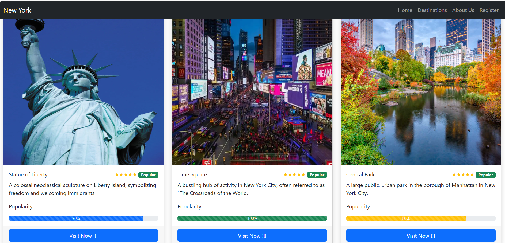
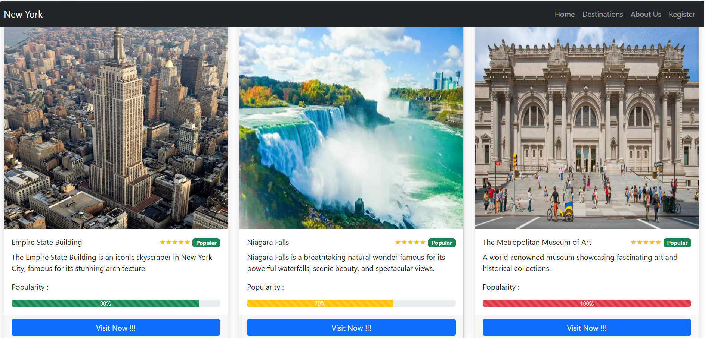
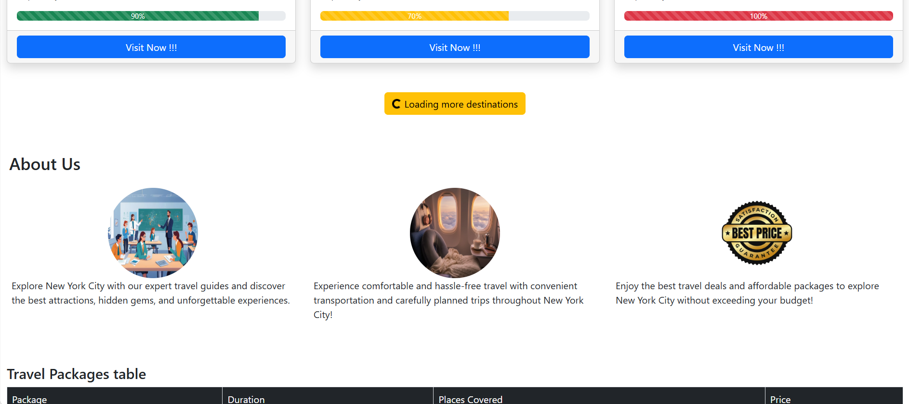
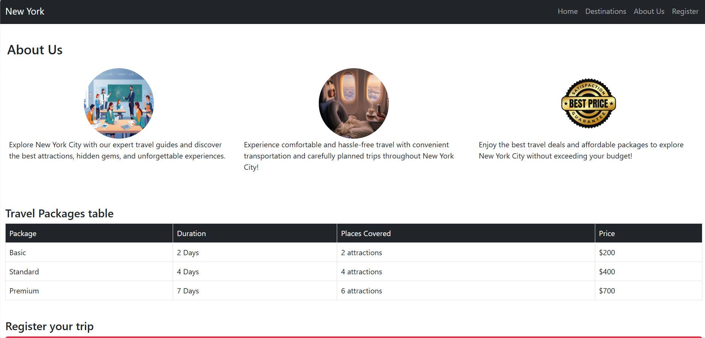
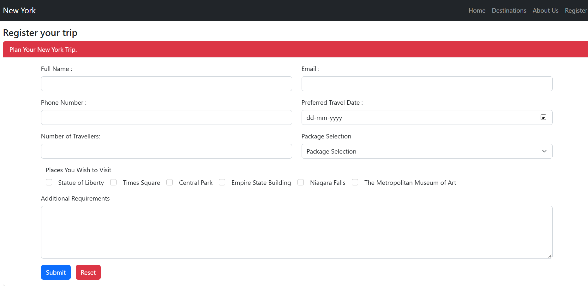
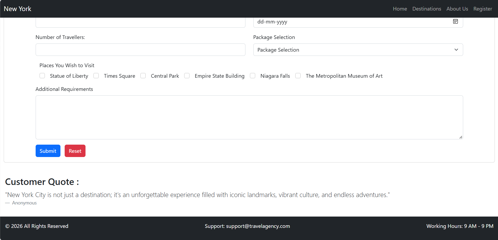

# 🗽 Explore New York City

A responsive tourism website built using **HTML5 and Bootstrap 5**, designed to help visitors explore popular destinations, discover travel packages, and register for a trip to New York City.

## 🌆 Project Overview

Explore New York City is my first Bootstrap project. The website showcases popular tourist attractions, introduces visitors to the city, and provides travel package details along with a trip registration form.

The project focuses on learning and implementing Bootstrap components and its responsive grid system.

## ✨ Features

- Responsive navigation bar
- Image carousel showcasing New York City
- Dismissible alert message
- Popular destination cards
- Destination ratings and badges
- Bootstrap progress bars
- About Us section
- Customer testimonial
- Travel packages comparison table
- Trip registration form
- Responsive layout using Bootstrap grid system
- Footer with contact information

## 🛠️ Technologies Used

- HTML5
- Bootstrap 5

## 📂 Project Structure

```text
Project-1-Explore-New-York/
│
├── index.html
└── README.md
└──Question.txt
```

## Screenshots of the website (For reference)

### Carousel Page


### Home Page


### Top Destinations


### Top Destinations


### About us


### Table Package


### Register your Trip


### Footer section


## 🚀 How to Run

1. Clone this repository or download the project.
2. Open the project folder.
3. Open `index.html` in your browser.
4. Explore the website!

## 📚 What I Learned

Through this project, I practised:

- Building responsive layouts using Bootstrap's grid system.
- Creating navigation bars and image carousels.
- Designing cards, buttons, and button groups.
- Working with Bootstrap alerts, badges, spinners, and progress bars.
- Creating forms and responsive tables.
- Organizing a multi-section website using Bootstrap components.

## 👨‍💻 Project Information

**Project:** 01 – Explore New York City  
**Category:** Frontend Web Development  
**Purpose:** Bootstrap Learning Project
